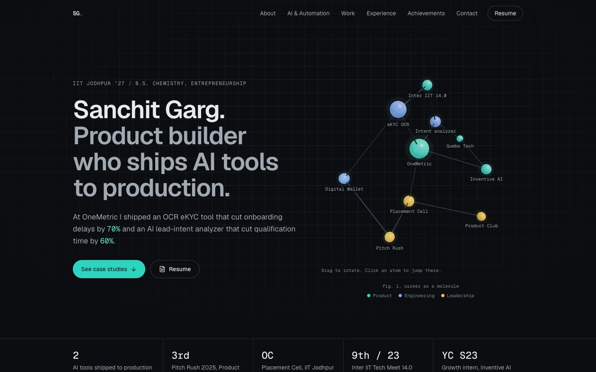
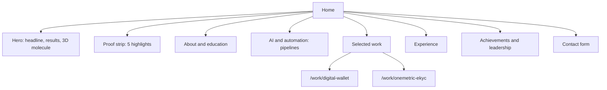
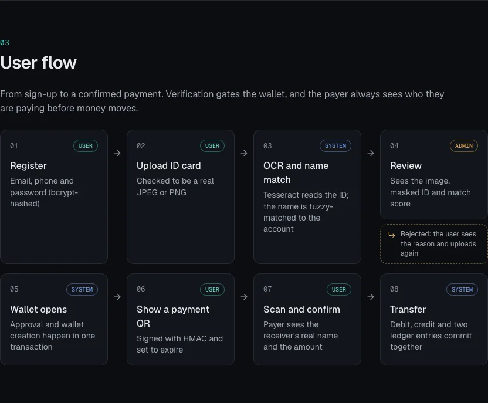
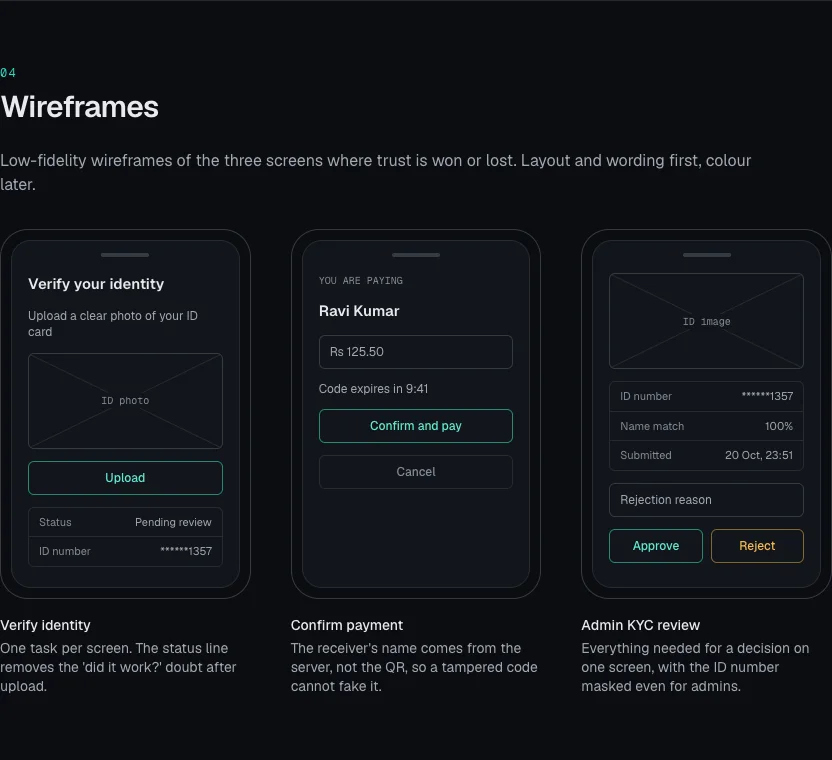
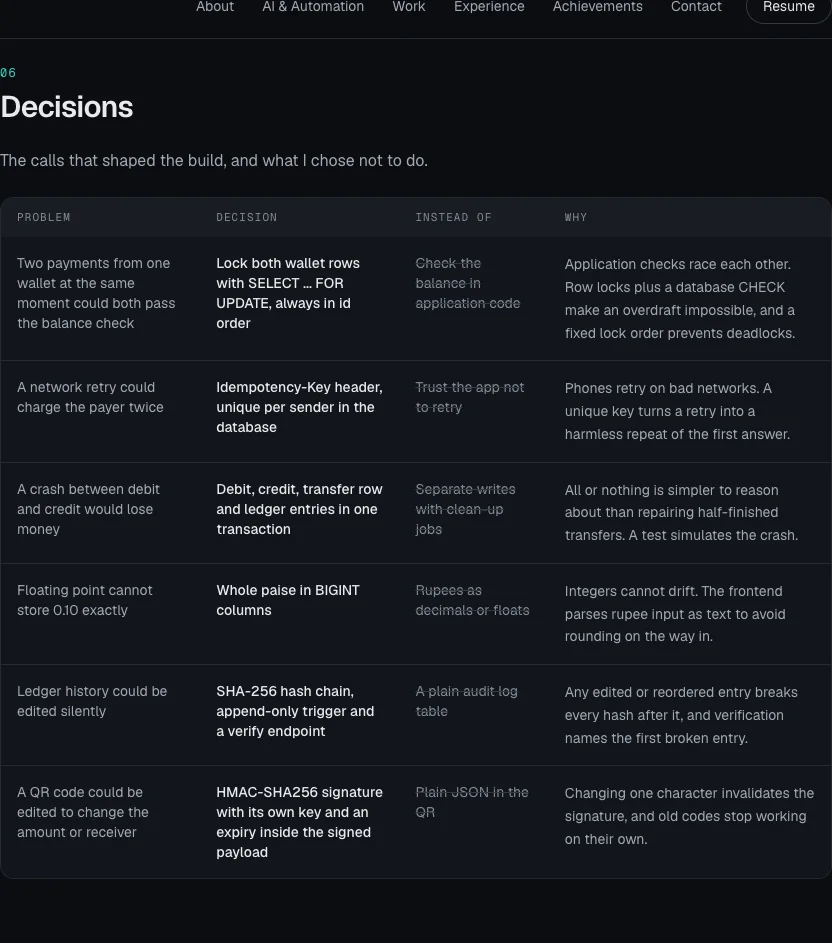
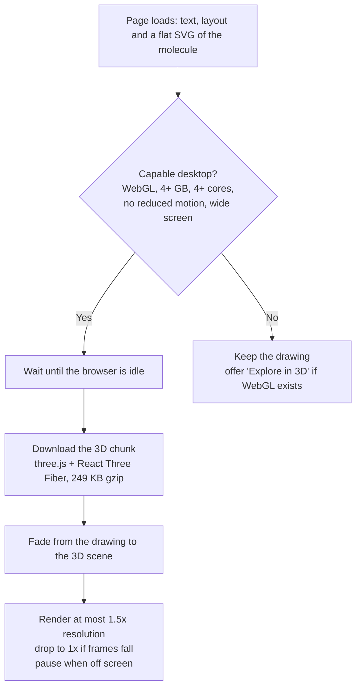
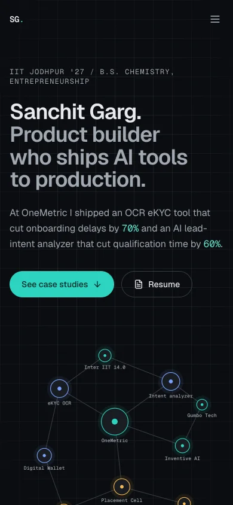
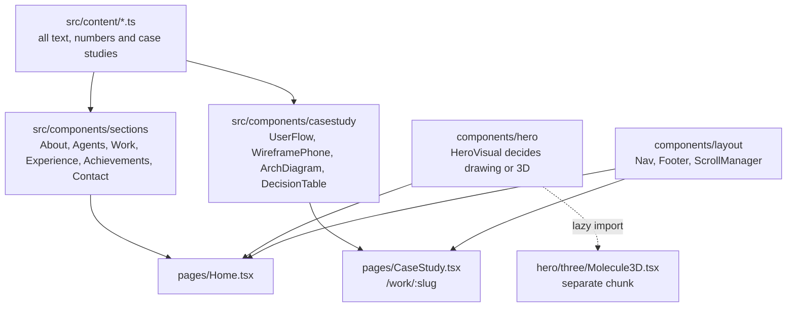

<div align="center">

# Sanchit Garg, Portfolio

**Product builder who ships AI tools to production. IIT Jodhpur '27.**

[Live site](https://sanchit-portfolio-blue.vercel.app) · [Digital Wallet case study](https://sanchit-portfolio-blue.vercel.app/work/digital-wallet) · [OneMetric eKYC case study](https://sanchit-portfolio-blue.vercel.app/work/onemetric-ekyc) · [LinkedIn](https://www.linkedin.com/in/sanchit-garg-791921286/)

</div>



## At a glance

| | |
|---|---|
| **Looking for** | AI engineer, product manager, product analyst and consulting roles |
| **Recent work** | OneMetric, Product Management Intern: OCR eKYC tool (**-70%** onboarding delays) and AI/ML B2B intent analyzer (**-60%** lead qualification time). 2 solutions reached production |
| **Leadership** | Overall Coordinator, Placement Cell, IIT Jodhpur. Former Overall Coordinator, The Product Club |
| **Recognition** | 3rd, Pitch Rush 2025. 9th of 23 IITs, Inter IIT Tech Meet 14.0 |
| **This repo** | The portfolio itself, designed and built from a blank page: React, TypeScript, Three.js, Lighthouse 99-100 on every page |

## How I designed this site

I treated the portfolio as a product with one user: a recruiter with 30 seconds.

**Problem.** The previous site was a generated template. It listed roles but buried the numbers, showed no design thinking, and its code was not in a form I could explain line by line.

**Goals.**
1. The strongest proof (70%, 60%, 2 in production) is visible without scrolling.
2. Every featured project shows *how* I think: problem, users, flows, wireframes, architecture and trade-offs.
3. One memorable visual that never costs a slow phone its first impression.

**Decisions.**

| Decision | Instead of | Why |
|---|---|---|
| Hero 3D plus fast HTML everywhere else | A fully 3D, navigable world | Recruiters scan; text must stay searchable, accessible and instant |
| A "career molecule": atoms are roles and projects, bonds are shared skills | A generic 3D shape | Ties the visual to my chemistry degree and my actual story |
| 3D loads only on capable desktops, after the page is idle | Loading 3D for everyone | Phones, low-memory devices and reduced-motion users get a flat drawing of the same molecule, with an opt-in button |
| Case studies on their own pages with a fixed 8-step structure | Longer cards on the home page | Gives each project room to show the process, and gives each a shareable link |
| All text in `src/content/*.ts` | Text written inside components | The site can be updated without touching layout code |
| Diagrams built from HTML and data | Exported images | Sharp at any size, readable by screen readers, editable as text |

**Information architecture.**



**Case-study template.** Each case study follows the same design process, so a reader always knows where to look:

`Problem -> Users and constraints -> User flow -> Wireframes -> Architecture -> Decisions -> Outcome -> What's next`

<table>
  <tr>
    <td width="50%"></td>
    <td width="50%"></td>
  </tr>
  <tr>
    <td align="center"><b>User flow</b>: who acts at each step, including the rejection path</td>
    <td align="center"><b>Wireframes</b>: the three screens where trust is won or lost</td>
  </tr>
</table>

<p align="center">
  
  <br>
  <b>Decisions</b>: every major call with the alternative I rejected and why
</p>

## How the 3D stays fast



- The 3D code is a separate file that phones never download unless the visitor asks for it.
- If WebGL fails, an error boundary quietly brings the drawing back.
- With reduced motion turned on, the molecule never spins or moves on scroll.

## Performance and accessibility

Lighthouse on the production build (`npm run build && npm run preview`), October 2026:

| Page | Device | Performance | Accessibility | Best practices | SEO |
|---|---|---|---|---|---|
| Home | Mobile | 99 | 100 | 100 | 100 |
| Home | Desktop | 100 | 100 | 100 | 100 |
| Digital Wallet case study | Mobile | 99 | 100 | 100 | 100 |
| OneMetric case study | Mobile | 99 | 100 | 100 | 100 |

- Largest Contentful Paint: about 2.0 s on throttled mobile, 0.4 s on desktop. Layout shift close to zero.
- Main bundle 82 KB gzip; images re-encoded to WebP.
- Every text colour passes WCAG AA contrast on every background; the faintest is 4.96:1 or higher.
- Skip link, visible focus outlines, 44 px touch targets, labelled form fields, alt text on every image.
- Canonical URLs, Open Graph and Twitter cards, JSON-LD `Person` data, sitemap and robots file.

<p align="center">
  
  <br>
  <b>Mobile</b>: the flat drawing loads instantly; 3D is opt-in
</p>

## Tech stack

| Area | Choice | Why |
|---|---|---|
| Framework | React 18, TypeScript (strict), Vite 6 | Fast builds, type-checked content and components |
| Styling | Tailwind CSS 4 with design tokens | One file (`src/styles/index.css`) defines every colour, font and radius |
| 3D | three.js, React Three Fiber, drei | 3D as React components; drei adds labels, drag controls and a performance monitor |
| Routing and SEO | React Router 6, react-helmet-async | Shareable case-study URLs with their own titles and descriptions |
| Contact form | EmailJS, loaded on submit | Works without a backend; the library downloads only when someone sends a message |
| Fonts and icons | Geist, Geist Mono (self-hosted), lucide-react | No third-party font requests; icons are tree-shaken |
| Hosting | Vercel | Preview deployment for every branch, production on `main` |

## Architecture



## Project structure

```
src/
  content/        site.ts, profile.ts, agents.ts, work.ts, experience.ts,
                  achievements.ts, caseStudies.ts, molecule.ts
  components/
    hero/         Hero, ProofStrip, HeroVisual, MoleculeStatic, deviceSupport
    hero/three/   Molecule3D (lazy-loaded)
    sections/     one component per home-page section, plus the contact form
    casestudy/    diagram components used by the case-study pages
    layout/       Nav, Footer, Layout, ScrollManager, useActiveSection
    ui/           Button, Container, Section, Tag, Emphasize
  pages/          Home, CaseStudy, NotFound
  styles/         index.css (design tokens and base styles)
design/           og-card.html, the source of the link-preview image
docs/screenshots/ images used in this README
public/           og-image.png, sitemap.xml, robots.txt, slide decks
scripts/          render-og.sh
```

## Run it locally

Requires Node.js 20 or newer.

```bash
npm install
npm run dev        # http://localhost:5173
npm run build      # type-check and production build into dist/
npm run preview    # serve the production build on http://localhost:4173
npm run lint
npm run og         # re-render public/og-image.png from design/og-card.html (needs Google Chrome)
```

To preview the fallbacks during development, add `?motion=reduce` or `?webgl=0` to the URL. These switches are stripped from production builds.

**Editing content.** Text lives in `src/content/`. To add a case study, add an entry to `src/content/caseStudies.ts` and a matching card in `src/content/work.ts`; the page at `/work/<slug>` is generated from it. Add the new URL to `public/sitemap.xml`.

## License

Code released under the [MIT License](LICENSE). Text, photos and case-study content are © Sanchit Garg.

## Author

**Sanchit Garg** · [sanchitgarg343@gmail.com](mailto:sanchitgarg343@gmail.com) · [LinkedIn](https://www.linkedin.com/in/sanchit-garg-791921286/) · [GitHub](https://github.com/SanchitSlayer)
